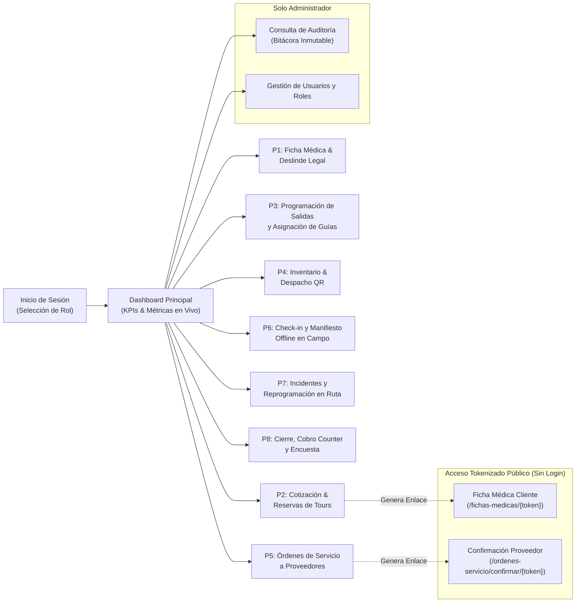

# Mapa de Navegación del Prototipo

**Proyecto:** EcoFlow Suite (Ecotrack Manager)  
**Sistema:** Plataforma Integral de Gestión Logística y Operativa para Ecoturismo y Aventura  
**Versión:** 1.0  
**Fecha:** Noviembre 2026  

---

## 1. Diagrama de Flujo de Navegación (Mermaid)

El siguiente diagrama modela el flujo de navegación entre pantallas según el rol del usuario autenticado y los enlaces públicos tokenizados:

---

## 2. Tabla Detallada por Pantalla

| Pantalla | Archivo / Vista | Se accede desde | Roles Autorizados | Endpoints que Consume |
| :--- | :--- | :--- | :--- | :--- |
| **Inicio de Sesión** | `index.html#login` | Carga inicial | Público | `GET /usuarios`, simulación token |
| **Dashboard** | `index.html#dashboard` | Menú lateral / Login | Administrador, Coordinador, Guía | `GET /salidas`, `GET /reservas`, `GET /equipos` |
| **P1: Ficha Médica & Deslinde** | `index.html#ficha-medica` | Dashboard / Enlace público | Cliente, Coordinador | `GET /pasajeros`, `GET /fichas_medicas`, `POST /fichas_medicas` |
| **P2: Cotización y Reservas** | `index.html#reservas` | Menú lateral / Dashboard | Administrador, Coordinador | `GET /tours`, `GET /reservas`, `POST /reservas` |
| **P3: Salidas y Guías** | `index.html#salidas` | Menú lateral / Dashboard | Administrador, Coordinador | `GET /tours`, `GET /guias`, `GET /salidas`, `POST /salidas` |
| **P4: Inventario QR** | `index.html#equipos` | Menú lateral / Dashboard | Administrador, Coordinador, Guía | `GET /equipos`, `POST /despachos_equipos`, `PATCH /equipos/{id}` |
| **P5: Órdenes a Proveedores** | `index.html#proveedores` | Menú lateral / Dashboard | Administrador, Coordinador | `GET /proveedores`, `GET /ordenes_servicio`, `POST /ordenes_servicio`, `PATCH /ordenes_servicio/{id}` |
| **P6: Check-in y Manifiesto** | `index.html#asistencia` | Menú lateral / Dashboard | Coordinador, Guía | `GET /salidas`, `GET /pasajeros`, `POST /asistencias` |
| **P7: Incidentes y Emergencia SOS** | `index.html#incidentes` | Menú lateral / Dashboard | Coordinador, Guía | `GET /salidas`, `GET /incidentes`, `POST /incidentes`, `PATCH /salidas/{id}` |
| **P8: Cierre, Cobro y Encuesta** | `index.html#cierre` | Menú lateral / Dashboard | Administrador, Coordinador, Guía | `GET /reservas`, `GET /consumos_adicionales`, `POST /consumos_adicionales`, `POST /pagos_liquidacion`, `PATCH /salidas/{id}` |
| **Auditoría del Sistema** | `index.html#auditoria` | Menú lateral | Solo Administrador | `GET /auditoria` |
