# Modelo de Datos

**Proyecto:** EcoFlow Suite (Ecotrack Manager)  
**Sistema:** Plataforma Integral de Gestión Logística y Operativa para Ecoturismo y Aventura  
**Fecha:** Noviembre 2026  
**Versión:** 1.0 (Aprobada)  
**Motor de Base de Datos:** PostgreSQL 16  

---

## 1. Entidades identificadas

A continuación se listan las entidades conceptuales del sistema, asociadas al requisito funcional o de seguridad que justifica su existencia:

| N.º | Entidad (snake_case) | Justificación y Requisito Asociado | Propósito en el Negocio |
| :---: | :--- | :--- | :--- |
| 1 | `rol` | RNF (Seguridad / RBAC) | Define los perfiles de acceso (Administrador, Coordinador, Guía). |
| 2 | `usuario` | RNF (Seguridad / RC-01) | Cuentas de acceso del personal interno con hash seguro (`password_hash`). |
| 3 | `auditoria` | RNF (Seguridad / RC-02) | Registro append-only inmutable de transacciones críticas y eventos del sistema. |
| 4 | `cliente` | RF-01, RF-03 | Titular de la reserva y contacto comercial principal. |
| 5 | `tour` | RF-02, RF-03, RF-05 | Catálogo maestro de excursiones, dificultad, aforos y ratios de seguridad guía/pax. |
| 6 | `regla_medica` | RF-02 | *Propuesta IA:* Condiciones médicas excluyentes parametrizadas por tour. |
| 7 | `reserva` | RF-03, RF-01, RF-15 | Registro comercial de contratación, cupos retenidos, estado y liquidación. |
| 8 | `pasajero` | RF-01, RF-02, RF-10 | Cada integrante del grupo con su token individual para autogestión médica. |
| 9 | `ficha_medica` | RF-01, RF-02, RF-11 | Declaración jurada de antecedentes de salud, alergias y firma digital del deslinde. |
| 10 | `guia` | RF-04, RF-05 | Ficha técnica del personal de campo, licencias y parámetros de descanso. |
| 11 | `salida` | RF-04, RF-05, RF-10, RF-15 | Instancia operativa en fecha y horario de un tour programado. |
| 12 | `salida_reserva` | RF-03, RF-04 | Entidad asociativa (N:M) que vincula reservas comerciales a una salida operativa. |
| 13 | `asignacion_guia` | RF-04, RF-05 | Entidad asociativa (N:M) que asigna guías a una salida con roles (principal/auxiliar). |
| 14 | `equipo` | RF-06, RF-07 | Inventario serializado con código QR de elementos técnicos y de seguridad. |
| 15 | `despacho_equipo` | RF-06, RF-07 | Entidad asociativa (N:M) que registra entrega y retorno físico de equipos en salidas. |
| 16 | `proveedor` | RF-08, RF-09 | Aliados logísticos externos (empresas de transporte y restaurantes comensales). |
| 17 | `orden_servicio` | RF-08, RF-09 | Contratos operativos con detalle consolidado de comensales, dietas y token one-click. |
| 18 | `asistencia` | RF-10, RF-11 | Marcado presencial de check-in en campo con soporte de sincronización offline. |
| 19 | `incidente` | RF-12, RF-13 | Bitácora de contingencias en ruta, propuesta de desvíos y activación de SOS médico. |
| 20 | `consumo_adicional`| RF-14, RF-15 | Servicios e insumos extraordinarios consumidos en ruta cargados a la reserva. |
| 21 | `pago_liquidacion` | RF-15, RF-03 | Transacciones financieras de cobro de anticipos y saldo final en counter. |
| 22 | `encuesta_satisfaccion`| RF-15 | Calificación post-servicio desacoplada enviada al finalizar el tour. |

---

## 2. Diccionario de datos

### 2.1 Entidades de Seguridad (RNF, RBAC, RC-01, RC-02)

#### Tabla: `rol`
| Atributo | Tipo Conceptual | Oblig. | Único | Regla o descripción | Req. |
| :--- | :--- | :---: | :---: | :--- | :---: |
| `id` | Entero (PK) | Sí | Sí | Identificador secuencial del rol. | RNF |
| `nombre` | Texto corto | Sí | Sí | Denominación del rol: `administrador`, `coordinador`, `guia`. | RBAC |
| `descripcion`| Texto largo | No | No | Alcance de responsabilidades y permisos. | RBAC |

#### Tabla: `usuario`
| Atributo | Tipo Conceptual | Oblig. | Único | Regla o descripción | Req. |
| :--- | :--- | :---: | :---: | :--- | :---: |
| `id` | Entero (PK) | Sí | Sí | Identificador del usuario del sistema. | RC-01 |
| `rol_id` | Entero (FK) | Sí | No | Rol asignado (referencia a `rol.id`). | RBAC |
| `nombres` | Texto corto | Sí | No | Nombres del empleado. | RC-01 |
| `apellidos` | Texto corto | Sí | No | Apellidos del empleado. | RC-01 |
| `email` | Texto corto | Sí | Sí | Correo institucional único de acceso. | RC-01 |
| `password_hash`| Texto | Sí | No | Hash seguro (Argon2 / bcrypt); nunca texto plano. | RC-01 |
| `telefono` | Texto corto | No | No | Teléfono de contacto operativo. | RNF |
| `activo` | Booleano | Sí | No | Indicador de cuenta activa (Default: true). | RC-01 |

#### Tabla: `auditoria`
| Atributo | Tipo Conceptual | Oblig. | Único | Regla o descripción | Req. |
| :--- | :--- | :---: | :---: | :--- | :---: |
| `id` | Entero (PK) | Sí | Sí | Identificador secuencial del log de auditoría. | RC-02 |
| `usuario_id` | Entero (FK) | No | No | Usuario que ejecutó la acción (NULL si fue token público).| RC-02 |
| `accion` | Texto corto | Sí | No | Código de operación (ej. `RESERVA_CONFIRMADA`, `CHECKIN`).| RC-02 |
| `tabla_afectada`| Texto corto | Sí | No | Nombre de la entidad impactada. | RC-02 |
| `registro_id`| Entero | No | No | ID del registro modificado o creado. | RC-02 |
| `ip_origen` | Texto corto | Sí | No | Dirección IPv4 o IPv6 del cliente. | RC-02 |
| `resultado` | Texto corto | Sí | No | `EXITO` o `FALLO` con HTTP status code. | RC-02 |
| `detalles` | Texto largo | No | No | Información complementaria sin datos sensibles. | RC-02 |
| `creado_en` | Timestamp | Sí | No | Marca temporal UTC inmutable del evento. | RC-02 |

---

### 2.2 Entidades de Catálogo y Comerciales

#### Tabla: `tour`
| Atributo | Tipo Conceptual | Oblig. | Único | Regla o descripción | Req. |
| :--- | :--- | :---: | :---: | :--- | :---: |
| `id` | Entero (PK) | Sí | Sí | Identificador del tour. | RF-03 |
| `codigo` | Texto corto | Sí | Sí | Código mnemotécnico único (ej. `TR-RAFT-01`). | RF-03 |
| `nombre` | Texto corto | Sí | No | Nombre comercial del tour o expedición. | RF-03 |
| `nivel_dificultad`| Texto corto | Sí | No | Nivel: `bajo`, `moderado`, `alto`, `extremo`. | RF-02 |
| `capacidad_maxima`| Entero | Sí | No | Aforo máximo de pasajeros por salida (> 0). | RF-03 |
| `ratio_guia_turista`| Entero | Sí | No | Máximo número de turistas por guía (ej. 8). | RF-05 |
| `precio_base` | Decimal | Sí | No | Tarifa base por pasajero en USD (> 0). | RF-03 |
| `activo` | Booleano | Sí | No | Estado comercial del tour (Default: true). | RF-03 |

#### Tabla: `regla_medica`
| Atributo | Tipo Conceptual | Oblig. | Único | Regla o descripción | Req. |
| :--- | :--- | :---: | :---: | :--- | :---: |
| `id` | Entero (PK) | Sí | Sí | Identificador de la regla de restricción médica. | RF-02 |
| `tour_id` | Entero (FK) | Sí | No | Tour al que aplica la restricción. | RF-02 |
| `condicion_medica`| Texto corto | Sí | No | Nombre de la patología (ej. `cardiopatia`, `asma`). | RF-02 |
| `es_excluyente` | Booleano | Sí | No | Si es true, bloquea automáticamente al pasajero. | RF-02 |
| `descripcion` | Texto largo | No | No | Criterio médico y justificación de exclusión. | RF-02 |

#### Tabla: `cliente`
| Atributo | Tipo Conceptual | Oblig. | Único | Regla o descripción | Req. |
| :--- | :--- | :---: | :---: | :--- | :---: |
| `id` | Entero (PK) | Sí | Sí | Identificador único del cliente titular. | RF-01 |
| `dni_pasaporte` | Texto corto | Sí | Sí | Documento de identidad nacional o pasaporte. | RF-01 |
| `nombres` | Texto corto | Sí | No | Nombres del cliente. | RF-01 |
| `apellidos` | Texto corto | Sí | No | Apellidos del cliente. | RF-01 |
| `email` | Texto corto | Sí | Sí | Correo electrónico para cotización y vouchers. | RF-01 |
| `telefono` | Texto corto | Sí | No | Celular / WhatsApp de contacto directo. | RF-01 |

#### Tabla: `reserva`
| Atributo | Tipo Conceptual | Oblig. | Único | Regla o descripción | Req. |
| :--- | :--- | :---: | :---: | :--- | :---: |
| `id` | Entero (PK) | Sí | Sí | Identificador de la reserva. | RF-03 |
| `codigo_reserva`| Texto corto | Sí | Sí | Código único de reserva (ej. `RES-2026-001`). | RF-03 |
| `cliente_id` | Entero (FK) | Sí | No | Cliente titular que contrata. | RF-03 |
| `tour_id` | Entero (FK) | Sí | No | Tour seleccionado. | RF-03 |
| `fecha_tour` | Fecha | Sí | No | Fecha programada para la excursión. | RF-03 |
| `cantidad_pasajeros`| Entero | Sí | No | Número de pasajeros totales contratados (> 0). | RF-03 |
| `tipo_servicio` | Texto corto | Sí | No | `compartido` o `privado`. | RF-03 |
| `monto_total` | Decimal | Sí | No | Importe total liquidable en USD ($\ge$ 0). | RF-03 |
| `saldo_pendiente` | Decimal | Sí | No | Saldo deudor por liquidar en counter. | RF-15 |
| `estado` | Texto corto | Sí | No | `pendiente`, `confirmada`, `en_curso`, `liquidada`, `cancelada`. | RF-03 |

#### Tabla: `pasajero`
| Atributo | Tipo Conceptual | Oblig. | Único | Regla o descripción | Req. |
| :--- | :--- | :---: | :---: | :--- | :---: |
| `id` | Entero (PK) | Sí | Sí | Identificador del pasajero. | RF-01 |
| `reserva_id` | Entero (FK) | Sí | No | Reserva comercial a la que pertenece. | RF-01 |
| `dni_pasaporte` | Texto corto | Sí | No | Documento de identidad del pasajero. | RF-01 |
| `nombres` | Texto corto | Sí | No | Nombres completos del pasajero. | RF-01 |
| `apellidos` | Texto corto | Sí | No | Apellidos completos del pasajero. | RF-01 |
| `es_menor` | Booleano | Sí | No | True si es menor de edad (requiere tutor). | RF-01 |
| `token_ficha` | Texto corto | Sí | Sí | Token criptográfico de uso único para ficha web. | RF-01 |
| `estado_ficha`| Texto corto | Sí | No | `pendiente`, `completada`, `bloqueada_riesgo`. | RF-02 |

#### Tabla: `ficha_medica`
| Atributo | Tipo Conceptual | Oblig. | Único | Regla o descripción | Req. |
| :--- | :--- | :---: | :---: | :--- | :---: |
| `id` | Entero (PK) | Sí | Sí | Identificador de la ficha médica. | RF-01 |
| `pasajero_id` | Entero (FK) | Sí | Sí | Relación 1:1 con `pasajero`. | RF-01 |
| `antecedentes_salud`| Texto largo | No | No | Condiciones de salud declaradas (hipertensión, asma, etc.). | RF-01 |
| `alergias` | Texto largo | No | No | Alergias a picaduras, polen, medicamentos. | RF-01 |
| `requerimiento_dietetico`| Texto corto | No | No | `ninguno`, `vegetariano`, `vegano`, `celiaco`. | RF-08 |
| `contacto_emergencia_nombre`| Texto corto | Sí | No | Nombre del contacto familiar. | RF-01 |
| `contacto_emergencia_telefono`| Texto corto | Sí | No | Teléfono de emergencia. | RF-01 |
| `deslinde_firmado` | Booleano | Sí | No | True si firmó electrónicamente el deslinde legal. | RF-01 |
| `fecha_firma` | Timestamp | No | No | Fecha y hora UTC en que se firmó el deslinde. | RF-01 |
| `es_apto` | Booleano | Sí | No | Resultado de evaluación contra reglas médicas. | RF-02 |

---

### 2.3 Entidades de Operaciones, Personal e Itinerarios

#### Tabla: `guia`
| Atributo | Tipo Conceptual | Oblig. | Único | Regla o descripción | Req. |
| :--- | :--- | :---: | :---: | :--- | :---: |
| `id` | Entero (PK) | Sí | Sí | Identificador técnico del guía. | RF-04 |
| `usuario_id` | Entero (FK) | Sí | Sí | Cuenta de usuario vinculada (1:1). | RF-04 |
| `codigo_licencia`| Texto corto | Sí | Sí | Licencia oficial de guía de montaña/turismo. | RF-04 |
| `especialidad` | Texto corto | Sí | No | Ej. `alta_montana`, `rafting_aguas_bravas`, `trekking`.| RF-04 |
| `minutos_descanso_min`| Entero | Sí | No | Tiempo mínimo de reposo reglamentario (Default: 60). | RF-04 |

#### Tabla: `salida`
| Atributo | Tipo Conceptual | Oblig. | Único | Regla o descripción | Req. |
| :--- | :--- | :---: | :---: | :--- | :---: |
| `id` | Entero (PK) | Sí | Sí | Identificador de la salida operativa. | RF-04 |
| `tour_id` | Entero (FK) | Sí | No | Tour programado. | RF-04 |
| `fecha` | Fecha | Sí | No | Fecha de realización. | RF-04 |
| `hora_salida` | Hora | Sí | No | Hora planificada de partida. | RF-04 |
| `hora_retorno` | Hora | Sí | No | Hora planificada de retorno (hora_retorno > hora_salida). | RF-04 |
| `estado` | Texto corto | Sí | No | `programada`, `en_ruta`, `en_emergencia`, `cerrada`. | RF-13, RF-15 |

#### Tabla: `salida_reserva` (Entidad intermedia N:M)
| Atributo | Tipo Conceptual | Oblig. | Único | Regla o descripción | Req. |
| :--- | :--- | :---: | :---: | :--- | :---: |
| `id` | Entero (PK) | Sí | Sí | Identificador de la vinculación. | RF-03 |
| `salida_id` | Entero (FK) | Sí | No | Salida operativa asignada. | RF-04 |
| `reserva_id`| Entero (FK) | Sí | No | Reserva incluida en la salida. Clave compuesta única `(salida_id, reserva_id)`. | RF-04 |

#### Tabla: `asignacion_guia` (Entidad intermedia N:M)
| Atributo | Tipo Conceptual | Oblig. | Único | Regla o descripción | Req. |
| :--- | :--- | :---: | :---: | :--- | :---: |
| `id` | Entero (PK) | Sí | Sí | Identificador de la asignación. | RF-04 |
| `salida_id` | Entero (FK) | Sí | No | Salida en la que participa. | RF-04 |
| `guia_id` | Entero (FK) | Sí | No | Guía designado. Clave compuesta única `(salida_id, guia_id)`. | RF-04 |
| `rol_en_tour` | Texto corto | Sí | No | `principal` o `auxiliar`. | RF-05 |

---

### 2.4 Entidades de Equipamiento, Proveedores y Campo

#### Tabla: `equipo`
| Atributo | Tipo Conceptual | Oblig. | Único | Regla o descripción | Req. |
| :--- | :--- | :---: | :---: | :--- | :---: |
| `id` | Entero (PK) | Sí | Sí | Identificador del equipo técnico. | RF-06 |
| `codigo_qr` | Texto corto | Sí | Sí | Identificador serializado escaneable único. | RF-06 |
| `tipo_equipo` | Texto corto | Sí | No | Ej. `arnes`, `casco`, `kayak`, `cuerda_dinamica`. | RF-06 |
| `marca_modelo`| Texto corto | Sí | No | Fabricante y modelo técnico. | RF-06 |
| `estado` | Texto corto | Sí | No | `disponible`, `despachado`, `en_mantenimiento`, `baja`. | RF-07 |

#### Tabla: `despacho_equipo` (Entidad intermedia N:M)
| Atributo | Tipo Conceptual | Oblig. | Único | Regla o descripción | Req. |
| :--- | :--- | :---: | :---: | :--- | :---: |
| `id` | Entero (PK) | Sí | Sí | Identificador del despacho del ítem. | RF-06 |
| `salida_id` | Entero (FK) | Sí | No | Salida a la que se despacha. | RF-06 |
| `equipo_id` | Entero (FK) | Sí | No | Equipo técnico individual asignado. | RF-06 |
| `fecha_despacho`| Timestamp | Sí | No | Fecha/hora del escaneo de salida de bodega. | RF-06 |
| `fecha_retorno` | Timestamp | No | No | Fecha/hora del escaneo de retorno físico. | RF-07 |
| `estado_retorno`| Texto corto | No | No | `optimo`, `con_danio`, `requiere_inspeccion`. | RF-07 |
| `observaciones` | Texto largo | No | No | Detalle de daños o desgastes detectados. | RF-07 |

#### Tabla: `proveedor`
| Atributo | Tipo Conceptual | Oblig. | Único | Regla o descripción | Req. |
| :--- | :--- | :---: | :---: | :--- | :---: |
| `id` | Entero (PK) | Sí | Sí | Identificador del proveedor. | RF-08 |
| `ruc` | Texto corto | Sí | Sí | Registro tributario / identificación fiscal única. | RF-08 |
| `razon_social` | Texto corto | Sí | No | Nombre formal o comercial de la empresa. | RF-08 |
| `tipo_servicio`| Texto corto | Sí | No | `transporte` o `restaurante`. | RF-08 |
| `contacto_nombre`| Texto corto| Sí | No | Nombre del responsable o despachador. | RF-08 |
| `email` | Texto corto | Sí | No | Correo para recepción de órdenes y tokens. | RF-08 |
| `telefono` | Texto corto | Sí | No | Teléfono de coordinación operativa. | RF-08 |

#### Tabla: `orden_servicio`
| Atributo | Tipo Conceptual | Oblig. | Único | Regla o descripción | Req. |
| :--- | :--- | :---: | :---: | :--- | :---: |
| `id` | Entero (PK) | Sí | Sí | Identificador de la orden de servicio. | RF-08 |
| `numero_orden` | Texto corto | Sí | Sí | Código único de orden (ej. `ORD-2026-001`). | RF-08 |
| `salida_id` | Entero (FK) | Sí | No | Salida para la cual se contrata el servicio. | RF-08 |
| `proveedor_id` | Entero (FK) | Sí | No | Proveedor asignado. | RF-08 |
| `total_comensales_pax`| Entero | Sí | No | Total de comensales o pasajeros a transportar (> 0). | RF-08 |
| `resumen_dietas`| Texto largo | No | No | Desglose consolidado: vegetarianos, celíacos, alergias. | RF-08 |
| `token_confirmacion`| Texto corto| Sí | Sí | Token one-click para confirmación web sin login. | RF-09 |
| `estado` | Texto corto | Sí | No | `emitida`, `confirmada`, `cancelada`. | RF-09 |
| `confirmado_en`| Timestamp | No | No | Fecha/hora UTC de la confirmación por el proveedor. | RF-09 |
| `ip_confirmacion`| Texto corto| No | No | Dirección IP desde donde se confirmó el servicio. | RF-09 |

---

### 2.5 Entidades de Check-in, Contingencias y Liquidación

#### Tabla: `asistencia`
| Atributo | Tipo Conceptual | Oblig. | Único | Regla o descripción | Req. |
| :--- | :--- | :---: | :---: | :--- | :---: |
| `id` | Entero (PK) | Sí | Sí | Identificador del registro de asistencia. | RF-10 |
| `salida_id` | Entero (FK) | Sí | No | Salida en curso. | RF-10 |
| `pasajero_id` | Entero (FK) | Sí | No | Pasajero evaluado. Clave única compuesta `(salida_id, pasajero_id)`. | RF-10 |
| `estado_asistencia`| Texto corto | Sí | No | `presente`, `ausente_no_show`. | RF-10 |
| `hora_marcado` | Timestamp | Sí | No | Marca de tiempo UTC registrada localmente. | RF-10 |
| `sincronizado` | Booleano | Sí | No | True si ya fue sincronizado con la base central. | RF-10 |

#### Tabla: `incidente`
| Atributo | Tipo Conceptual | Oblig. | Único | Regla o descripción | Req. |
| :--- | :--- | :---: | :---: | :--- | :---: |
| `id` | Entero (PK) | Sí | Sí | Identificador de la contingencia o incidente. | RF-12 |
| `salida_id` | Entero (FK) | Sí | No | Salida afectada. | RF-12 |
| `tipo_incidente`| Texto corto | Sí | No | `clima_adverso`, `bloqueo_ruta`, `emergencia_medica`, `falla_mecanica`. | RF-12 |
| `severidad` | Texto corto | Sí | No | `leve`, `moderada`, `critica_sos`. | RF-13 |
| `descripcion` | Texto largo | Sí | No | Descripción detallada de lo acontecido. | RF-12 |
| `ruta_alterna_propuesta`| Texto largo| No | No | Nueva ruta sugerida para aprobación de Coordinación. | RF-12 |
| `estado_aprobacion`| Texto corto | Sí | No | `pendiente`, `aprobada`, `ejecutada_sos`. | RF-12, RF-13 |
| `reportado_en` | Timestamp | Sí | No | Timestamp de reporte por el guía en campo. | RF-12 |

#### Tabla: `consumo_adicional`
| Atributo | Tipo Conceptual | Oblig. | Único | Regla o descripción | Req. |
| :--- | :--- | :---: | :---: | :--- | :---: |
| `id` | Entero (PK) | Sí | Sí | Identificador del consumo extraordinario en ruta. | RF-14 |
| `salida_id` | Entero (FK) | Sí | No | Salida donde se produjo el consumo. | RF-14 |
| `reserva_id` | Entero (FK) | Sí | No | Reserva a cuya cuenta se carga el débito. | RF-14 |
| `descripcion` | Texto corto | Sí | No | Concepto: `alquiler_baston`, `hidratacion_extra`, etc. | RF-14 |
| `cantidad` | Entero | Sí | No | Unidades solicitadas (> 0). | RF-14 |
| `precio_unitario`| Decimal | Sí | No | Precio acordado en USD (> 0). | RF-14 |
| `subtotal` | Decimal | Sí | No | Total calculado (`cantidad * precio_unitario`). | RF-14 |
| `registrado_en`| Timestamp | Sí | No | Fecha/hora UTC de registro en app móvil. | RF-14 |

#### Tabla: `pago_liquidacion`
| Atributo | Tipo Conceptual | Oblig. | Único | Regla o descripción | Req. |
| :--- | :--- | :---: | :---: | :--- | :---: |
| `id` | Entero (PK) | Sí | Sí | Identificador de la transacción de cobro. | RF-15 |
| `reserva_id` | Entero (FK) | Sí | No | Reserva que recibe el abono. | RF-15 |
| `monto` | Decimal | Sí | No | Monto pagado en USD (> 0). | RF-15 |
| `metodo_pago` | Texto corto | Sí | No | `tarjeta_credito`, `transferencia`, `efectivo_counter`. | RF-15 |
| `fecha_pago` | Timestamp | Sí | No | Fecha y hora UTC del cobro en counter. | RF-15 |
| `referencia_transaccion`| Texto corto| No | No | Código voucher o número de operación bancaria. | RF-15 |

#### Tabla: `encuesta_satisfaccion`
| Atributo | Tipo Conceptual | Oblig. | Único | Regla o descripción | Req. |
| :--- | :--- | :---: | :---: | :--- | :---: |
| `id` | Entero (PK) | Sí | Sí | Identificador de la encuesta. | RF-15 |
| `reserva_id` | Entero (FK) | Sí | Sí | Encuesta por reserva (1:1). | RF-15 |
| `puntuacion_general`| Entero | No | No | Escala del 1 al 5 estrellas (CHECK: 1 a 5). | RF-15 |
| `comentarios` | Texto largo | No | No | Opinión del cliente sobre guías y servicios. | RF-15 |
| `enviado_en` | Timestamp | Sí | No | Momento del despacho del enlace web. | RF-15 |
| `respondido_en`| Timestamp | No | No | Momento en que el cliente completó la encuesta. | RF-15 |

---

## 3. Relaciones y cardinalidades

### 3.1 Relaciones 1:1 (Uno a Uno)
1. `pasajero ||--o| ficha_medica`: Cada pasajero tiene a lo sumo una ficha médica; cada ficha pertenece exactamente a un pasajero.
2. `usuario ||--o| guia`: Un usuario del personal puede tener como máximo una ficha técnica de guía (si su rol es guía); cada ficha técnica de guía corresponde exactamente a un usuario.
3. `reserva ||--o| encuesta_satisfaccion`: Cada reserva completada genera a lo sumo una encuesta de satisfacción.

### 3.2 Relaciones 1:N (Uno a Muchos)
1. `rol ||--o{ usuario`: Un rol agrupa a muchos usuarios; cada usuario tiene exactamente un rol asignado.
2. `cliente ||--o{ reserva`: Un cliente titular realiza una o muchas reservas; cada reserva pertenece a exactamente un cliente.
3. `tour ||--o{ regla_medica`: Un tour define muchas reglas médicas de exclusión; cada regla pertenece a un tour.
4. `tour ||--o{ reserva`: Un tour recibe muchas reservas; cada reserva corresponde a un tour específico.
5. `tour ||--o{ salida`: Un tour se ejecuta en múltiples salidas programadas; cada salida corresponde a un tour.
6. `reserva ||--|{ pasajero`: Una reserva incluye uno o muchos pasajeros; cada pasajero pertenece a una reserva.
7. `salida ||--o{ orden_servicio`: Una salida genera órdenes de servicio a distintos proveedores (transporte, restaurante).
8. `proveedor ||--o{ orden_servicio`: Un proveedor recibe muchas órdenes de servicio.
9. `salida ||--o{ incidente`: Una salida puede registrar cero o varios incidentes en ruta.
10. `reserva ||--o{ consumo_adicional`: Una reserva puede acumular múltiples consumos extraordinarios durante la actividad.
11. `reserva ||--o{ pago_liquidacion`: Una reserva recibe uno o más pagos (adelanto y liquidación final).
12. `usuario ||--o{ auditoria`: Un usuario ejecuta múltiples operaciones auditadas en el sistema.

### 3.3 Relaciones N:M Resueltas mediante Entidades Intermedias
1. **Salida y Reserva:**
   - Una salida agrupa múltiples reservas comerciales, y una reserva podría reorganizarse o agruparse.
   - **Entidad intermedia:** `salida_reserva` (vincula `salida_id` y `reserva_id`).
2. **Salida y Guía:**
   - Una salida requiere múltiples guías (principal y auxiliares por ratio de seguridad 1:8), y un guía participa en distintas salidas a lo largo del tiempo.
   - **Entidad intermedia:** `asignacion_guia` (vincula `salida_id` y `guia_id`, con atributo `rol_en_tour`).
3. **Salida y Equipo:**
   - Una salida despacha decenas de equipos de seguridad serializados (cascos, arneses), y un equipo técnico es utilizado en múltiples salidas durante su vida útil.
   - **Entidad intermedia:** `despacho_equipo` (vincula `salida_id` y `equipo_id`, con marcas de entrega y retorno).
4. **Salida y Pasajero (Check-in presencial):**
   - Una salida evalúa el abordaje de múltiples pasajeros.
   - **Entidad intermedia:** `asistencia` (vincula `salida_id` y `pasajero_id`, registrando `estado_asistencia` y `hora_marcado`).

---

## 4. Diagrama entidad-relación

El siguiente diagrama en sintaxis Mermaid modela conceptual y lógicamente las 22 entidades y sus vínculos:

```mermaid
erDiagram
    ROL ||--o{ USUARIO : agrupa
    USUARIO ||--o| GUIA : "perfil tecnico"
    USUARIO ||--o{ AUDITORIA : ejecuta
    
    CLIENTE ||--o{ RESERVA : contrata
    TOUR ||--o{ RESERVA : comercializa
    TOUR ||--o{ REGLA_MEDICA : condiciona
    TOUR ||--o{ SALIDA : programa
    
    RESERVA ||--|{ PASAJERO : contiene
    PASAJERO ||--o| FICHA_MEDICA : declara
    
    SALIDA ||--o{ SALIDA_RESERVA : agrupa
    RESERVA ||--o{ SALIDA_RESERVA : integra
    
    SALIDA ||--o{ ASIGNACION_GUIA : asigna
    GUIA ||--o{ ASIGNACION_GUIA : opera
    
    SALIDA ||--o{ DESPACHO_EQUIPO : despacha
    EQUIPO ||--o{ DESPACHO_EQUIPO : entrega
    
    SALIDA ||--o{ ORDEN_SERVICIO : emite
    PROVEEDOR ||--o{ ORDEN_SERVICIO : atiende
    
    SALIDA ||--o{ ASISTENCIA : evalua
    PASAJERO ||--o{ ASISTENCIA : marca
    
    SALIDA ||--o{ INCIDENTE : reporta
    
    RESERVA ||--o{ CONSUMO_ADICIONAL : genera
    SALIDA ||--o{ CONSUMO_ADICIONAL : registra
    
    RESERVA ||--o{ PAGO_LIQUIDACION : abona
    RESERVA ||--o| ENCUESTA_SATISFACCION : califica

    ROL {
        int id PK
        string nombre UK
        string descripcion
    }

    USUARIO {
        int id PK
        int rol_id FK
        string email UK
        string password_hash
        string nombres
        string apellidos
        boolean activo
    }

    AUDITORIA {
        int id PK
        int usuario_id FK
        string accion
        string tabla_afectada
        int registro_id
        string ip_origen
        string resultado
        timestamp creado_en
    }

    CLIENTE {
        int id PK
        string dni_pasaporte UK
        string nombres
        string apellidos
        string email UK
        string telefono
    }

    TOUR {
        int id PK
        string codigo UK
        string nombre
        string nivel_dificultad
        int capacidad_maxima
        int ratio_guia_turista
        decimal precio_base
        boolean activo
    }

    REGLA_MEDICA {
        int id PK
        int tour_id FK
        string condicion_medica
        boolean es_excluyente
    }

    RESERVA {
        int id PK
        string codigo_reserva UK
        int cliente_id FK
        int tour_id FK
        date fecha_tour
        int cantidad_pasajeros
        string tipo_servicio
        decimal monto_total
        decimal saldo_pendiente
        string estado
    }

    PASAJERO {
        int id PK
        int reserva_id FK
        string dni_pasaporte
        string nombres
        string apellidos
        boolean es_menor
        string token_ficha UK
        string estado_ficha
    }

    FICHA_MEDICA {
        int id PK
        int pasajero_id FK
        string antecedentes_salud
        string alergias
        string requerimiento_dietetico
        string contacto_emergencia_nombre
        string contacto_emergencia_telefono
        boolean deslinde_firmado
        timestamp fecha_firma
        boolean es_apto
    }

    GUIA {
        int id PK
        int usuario_id FK
        string codigo_licencia UK
        string especialidad
        int minutos_descanso_min
    }

    SALIDA {
        int id PK
        int tour_id FK
        date fecha
        time hora_salida
        time hora_retorno
        string estado
    }

    SALIDA_RESERVA {
        int id PK
        int salida_id FK
        int reserva_id FK
    }

    ASIGNACION_GUIA {
        int id PK
        int salida_id FK
        int guia_id FK
        string rol_en_tour
    }

    EQUIPO {
        int id PK
        string codigo_qr UK
        string tipo_equipo
        string marca_modelo
        string estado
    }

    DESPACHO_EQUIPO {
        int id PK
        int salida_id FK
        int equipo_id FK
        timestamp fecha_despacho
        timestamp fecha_retorno
        string estado_retorno
        string observaciones
    }

    PROVEEDOR {
        int id PK
        string ruc UK
        string razon_social
        string tipo_servicio
        string contacto_nombre
        string email
        string telefono
    }

    ORDEN_SERVICIO {
        int id PK
        string numero_orden UK
        int salida_id FK
        int proveedor_id FK
        int total_comensales_pax
        string resumen_dietas
        string token_confirmacion UK
        string estado
        timestamp confirmado_en
        string ip_confirmacion
    }

    ASISTENCIA {
        int id PK
        int salida_id FK
        int pasajero_id FK
        string estado_asistencia
        timestamp hora_marcado
        boolean sincronizado
    }

    INCIDENTE {
        int id PK
        int salida_id FK
        string tipo_incidente
        string severidad
        string descripcion
        string ruta_alterna_propuesta
        string estado_aprobacion
        timestamp reportado_en
    }

    CONSUMO_ADICIONAL {
        int id PK
        int salida_id FK
        int reserva_id FK
        string descripcion
        int cantidad
        decimal precio_unitario
        decimal subtotal
        timestamp registrado_en
    }

    PAGO_LIQUIDACION {
        int id PK
        int reserva_id FK
        decimal monto
        string metodo_pago
        timestamp fecha_pago
        string referencia_transaccion
    }

    ENCUESTA_SATISFACCION {
        int id PK
        int reserva_id FK
        int puntuacion_general
        string comentarios
        timestamp enviado_en
        timestamp respondido_en
    }
```

---

## 5. Matriz CRUD proceso-entidad

La siguiente matriz detalla cómo interactúa cada uno de los **8 procesos transaccionales**, más el **Inicio de Sesión** y la **Auditoría**, sobre las entidades del sistema:  
- **C** = Crear (Create)  
- **R** = Leer / Consultar (Read)  
- **U** = Actualizar (Update)  
- **D** = Eliminar (Delete)  

| Proceso Transaccional | rol / usuario | cliente / pasajero | tour / regla | reserva / salida | ficha_medica | guia / asign. | equipo / desp. | proveedor / orden | asist. | incident. | consumo / pago | encuesta | auditoria |
| :--- | :---: | :---: | :---: | :---: | :---: | :---: | :---: | :---: | :---: | :---: | :---: | :---: | :---: |
| **Inicio de sesión (Auth)** | R | | | | | | | | | | | | C |
| **P1: Ficha médica y deslinde (RF-01, RF-02)** | | R, U | R | R | **C, R, U** | | | | | | | | C |
| **P2: Cotización y reservas (RF-03)** | | **C, R** | R | **C, R, U** | | | | | | | **C** (seña) | | C |
| **P3: Programación de salidas y guías (RF-04, RF-05)** | | R | R | **C, R, U** | | **C, R, U, D** | | | | | | | C |
| **P4: Inventario y despacho QR (RF-06, RF-07)** | | | | R | | | **C, R, U** | | | | | | C |
| **P5: Órdenes a proveedores (RF-08, RF-09)** | | R | | R | R (dietas) | | | **C, R, U** | | | | | C |
| **P6: Check-in y asistencia en campo (RF-10, RF-11)** | | R | | R | R (apto) | R | | | **C, R, U** | | | | C |
| **P7: Incidentes y contingencias (RF-12, RF-13)** | | | | R, U | | R | | R | | **C, R, U** | | | C |
| **P8: Cierre, cobro y encuesta (RF-14, RF-15)** | | R | | R, U | | | R, U (retorno) | | R | | **C, R, U** | **C, R, U** | C |
| **Consulta de Auditoría (Admin)** | R | R | R | R | R | R | R | R | R | R | R | R | **R** |

> **Cumplimiento de las reglas de matriz:**
> 1. Cada proceso opera sobre al menos una entidad del negocio.
> 2. Todas las entidades cuentan con al menos un proceso que las crea (C).
> 3. Toda operación que modifica o registra datos asienta un registro de evento en la entidad de `auditoria`.

---

## 6. Decisiones de diseño y preguntas resueltas

1. **Cumplimiento de Tercera Forma Normal (3FN):**
   - **1FN:** Todos los atributos son atómicos (sin listas compuestas dentro de un campo) y cada tabla posee una clave primaria bien definida.
   - **2FN:** En tablas intermedias compuestas (`salida_reserva`, `asignacion_guia`, `despacho_equipo`), todos los atributos no clave dependen enteramente de la clave primaria.
   - **3FN:** Se eliminaron dependencias transitivas. Por ejemplo, los datos del cliente titular residen exclusivamente en `cliente`; la reserva solo almacena `cliente_id`. La ficha médica depende directamente del `pasajero_id`, y no de la `reserva`.
   - *Excepción justificada:* Se almacena `subtotal` en `consumo_adicional` para congelar el cálculo contable al momento de la venta y resistir eventuales cambios futuros de precios unitarios.
2. **Tokens de Acceso sin Contraseña (RF-01 y RF-09):**
   - Se diseñaron atributos `token_ficha` en `pasajero` y `token_confirmacion` en `orden_servicio`. Esto permite a turistas y aliados confirmar transacciones en un solo clic mediante HTTPS, cumpliendo el requisito de cero fricción sin comprometer la seguridad.
3. **Manejo de Contraseñas (RC-01):**
   - El atributo es estrictamente `password_hash` con longitud adecuada para algoritmos de alta resistencia (Argon2id / bcrypt). Nunca se almacena en texto plano.

---

## 7. Modelo físico para PostgreSQL 16

En correspondencia con la arquitectura validada en `INFRAESTRUCTURA.md`, se adaptan los tipos conceptuales al motor **PostgreSQL 16**:

### 7.1 Mapeo de Tipos de Datos
| Tipo Conceptual | Tipo Físico en PostgreSQL 16 | Justificación Técnica |
| :--- | :--- | :--- |
| Identificador autonumérico (PK) | `INTEGER GENERATED ALWAYS AS IDENTITY` | Estándar SQL moderno en PostgreSQL, más robusto que `SERIAL`. |
| Texto corto | `VARCHAR(n)` | Longitudes acotadas (120 para nombres/emails, 30 para códigos y teléfonos). |
| Texto largo | `TEXT` | Almacenamiento eficiente de descripciones y bitácoras sin límite artificial. |
| Moneda / Dinero | `NUMERIC(10,2)` | Exactitud decimal fija; previene errores de redondeo de flotantes (`FLOAT`). |
| Fecha | `DATE` | Almacena año, mes y día (`YYYY-MM-DD`). |
| Hora | `TIME` | Almacena hora y minuto (`HH:MM:SS`). |
| Timestamp con zona horaria | `TIMESTAMP WITH TIME ZONE DEFAULT CURRENT_TIMESTAMP` | Precisión UTC absoluta para eventos de auditoría y deslindes. |
| Booleano | `BOOLEAN` | Tipo nativo `true` / `false` de PostgreSQL. |
| Conjunto de estados | `VARCHAR(30) + CHECK (col IN (...))` | Mayor portabilidad y facilidad de evolución frente al tipo `ENUM`. |

### 7.2 Restricciones e Índices Estratégicos
1. **Regla de No Overbooking en Salidas (RF-03):**  
   Controlada mediante suma transaccional contra `tour.capacidad_maxima`.
2. **Regla de No Solapamiento de Guías (RF-04):**  
   Validada en transacción con consulta de choque de intervalos `(hora_salida, hora_retorno + INTERVAL '60 minutes')`.
3. **Prevención de Doble Marcado de Asistencia (RF-10):**  
   Restricción de unicidad compuesta: `UNIQUE (salida_id, pasajero_id)`.
4. **Prevención de Despacho de Equipos Dañados (RF-07):**  
   `CHECK (estado IN ('disponible', 'despachado', 'en_mantenimiento', 'baja'))`.
5. **Índices de Búsqueda Frecuente:**
   - `idx_reserva_fecha` sobre `reserva(fecha_tour, estado)`.
   - `idx_equipo_qr` sobre `equipo(codigo_qr)`.
   - `idx_asistencia_salida` sobre `asistencia(salida_id)`.
   - `idx_orden_token` sobre `orden_servicio(token_confirmacion)`.
   - `idx_pasajero_token` sobre `pasajero(token_ficha)`.

### 7.3 Reglas validadas a nivel de Backend
- Validación algorítmica de compatibilidad médica cruzando texto libre con catálogo excluyente (RF-02).
- Validación de 60 minutos de descanso entre salidas consecutivas de un mismo guía (RF-04).
- Validación de proporción guía/turista $\le 1:8$ antes de liberar salida a despacho (RF-05).
- Despacho asíncrono de correo y WhatsApp al cambiar de estado reservas u órdenes.
